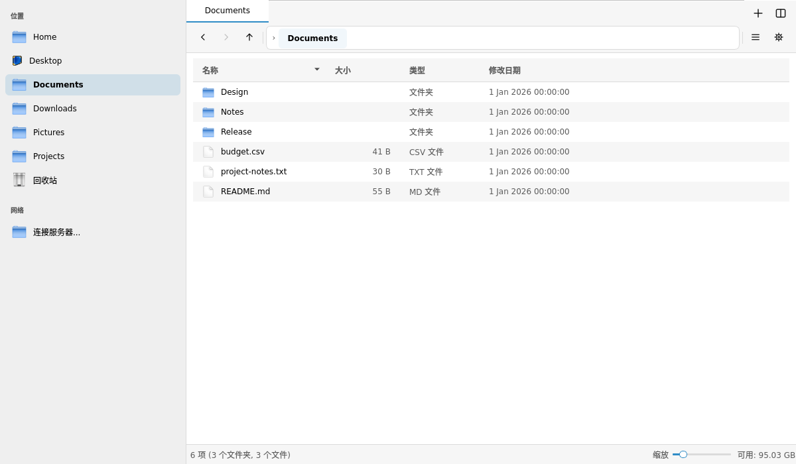

# QtFileMgr

A Qt Widgets file-management component that can be embedded in an existing
application, with a standalone tabbed, split-pane application and optional
SSH/SFTP support.

[中文说明](README.zh-CN.md) · [Build and test](docs/TESTING.md) ·
[Complete examples](docs/EXAMPLES.md) · [Known limitations](docs/KNOWN_LIMITATIONS.md) · [License and sources](NOTICE.md)



[Icon view](docs/images/icons.png) · [Split panes](docs/images/split.png) ·
[Filtering](docs/images/filter.png)

## Features

- Embeddable `QtFileMgrWidget`; workspace with tabs, split panes and session state.
- Icon, compact and detail views, filtering, search, bounded text/image preview.
- Local copy/move, conflict policies, progress, cooperative cancellation and limited undo.
- Injectable `QtFileMgrIO` and protocol providers for application-specific storage.
- Optional libssh backend: SSH host-key verification, SFTP browsing and transfers.
- Palette-derived visuals that follow the host application's colors.

QtFileMgr is an early source release. Read the [operation and recovery
boundaries](docs/KNOWN_LIMITATIONS.md), especially overwrite/undo, cancellation,
credentials and custom-backend ownership. Navigation restrictions are not a
security sandbox. UI strings are currently predominantly Chinese.

## Dependencies and supported builds

Linux is the tested platform. CMake 3.16+, a C++17 compiler and Qt Core/Gui/Widgets
are required. Qt 5.12 is the minimum source baseline; Qt 5.15 and Qt 6 are covered
by the CI matrix. Exact locally verified versions are recorded in
[VALIDATION.md](docs/VALIDATION.md). Windows and macOS are not release targets yet.

For Debian/Ubuntu, install either Qt 5:

```sh
sudo apt-get update
sudo apt-get install build-essential cmake ninja-build python3 qtbase5-dev
```

or Qt 6 (replace `qtbase5-dev` with `qt6-base-dev`). SSH builds additionally need:

```sh
sudo apt-get install pkg-config libssh-dev
```

## Build and run

Run from the source root. CMake builds the project with the public dependencies
listed above.

```sh
cmake -S . -B build -G Ninja \
  -DQTFILEMGR_QT_MAJOR=5 -DQTFILEMGR_WITH_SSH=OFF \
  -DCMAKE_BUILD_TYPE=Release
cmake --build build --parallel 2
(cd build && ctest --output-on-failure)
./build/qtfilemgr_app
```

Use `-DQTFILEMGR_QT_MAJOR=6` for Qt 6. Set `-DQTFILEMGR_WITH_SSH=ON` to compile
SSH/SFTP (the option defaults to ON); missing libssh is an explicit configure
error. OFF builds contain no libssh dependency or built-in SSH connection UI.
A build selects one Qt major version; do not mix Qt 5 and Qt 6 in one process.
`-DBUILD_TESTING=OFF` omits tests and their Python dependency.

## Install and use from another project

```sh
cmake --install build --prefix "$PWD/install"
```

In the consuming project's CMakeLists.txt:

```cmake
find_package(QtFileMgr 0.1 CONFIG REQUIRED)
target_link_libraries(my_application PRIVATE QtFileMgr::QtFileMgr)
```

Configure that project with `-DCMAKE_PREFIX_PATH=/path/to/install`. The imported
target carries Qt dependencies, include paths and the chosen SSH feature macro.
See [the installed consumer smoke test](tests/installed_consumer) for a complete
small build. `add_subdirectory()` can also consume this source tree directly.

To embed the component:

```cpp
#include <QtFileMgrWidget.h>

QtFileMgrConfig config;
config.rootPath = initialDirectory;
auto *manager = new QtFileMgrWidget(config, parentWidget);
layout->addWidget(manager);
connect(manager, &QtFileMgrWidget::fileActivated, hostWindow,
        [hostWindow](const QString &path) { hostWindow->openDocument(path); });
```

The host decides what opening a file means. An injected IO backend stays owned by
the caller and must outlive its consumers, on the same GUI thread.

Two [complete examples](docs/EXAMPLES.md) demonstrate embedding in an existing
window with a host-owned preview and implementing a read-only `memory:///` IO
backend. Enable `-DQTFILEMGR_BUILD_EXAMPLES=ON`; run
`build/examples/embedded/qtfilemgr_example_embedded` or
`build/examples/memory_io/qtfilemgr_example_memory_io`. Each also builds as a
separate `find_package` consumer against the installed library. Both support
`--smoke-test` and `--screenshot PATH`.

Undo now checks an execution-time identity/revision proof; changed or unverifiable
objects are preserved. Remote overwrite keeps an old-target backup and attempts
safe restoration if install fails. See [SAFETY.md](docs/SAFETY.md) for the bounded
local validation, retained SSH backups and recovery process.

## Configuration

The standalone build uses the `QtFileMgr/QtFileMgr` QSettings namespace. Default
JSON configuration lives under the platform's generic configuration directory at
`qtfilemgr/mgr_default_config.json`. `QTFILEMGR_CONFIG_FILE` explicitly selects a
different JSON file. CMake is the supported build entry point.

## Validation and contributions

[GitHub Actions](.github/workflows/ci.yml) defines Linux Qt 5/6 × SSH ON/OFF
builds, isolated offscreen regression tests, opt-in real loopback SSH integration
and an installed-package consumer test. Check the repository Actions tab for
results associated with a particular commit.

For real SSH integration, installation checks and test coverage see
[TESTING.md](docs/TESTING.md). Report reproduction steps, Qt version, build options
and sanitized diagnostics with issues. Changes that recover from invalid data,
skip values or degrade behavior must emit `qWarning` with source/context and the
skipped value. Keep tests meaningful and update public behavior documentation.

## License

Author and maintainer: **Spike**. [MIT](LICENSE), copyright 2026 Spike.
See [NOTICE.md](NOTICE.md) for code provenance, design references and separate
dependency licenses.
