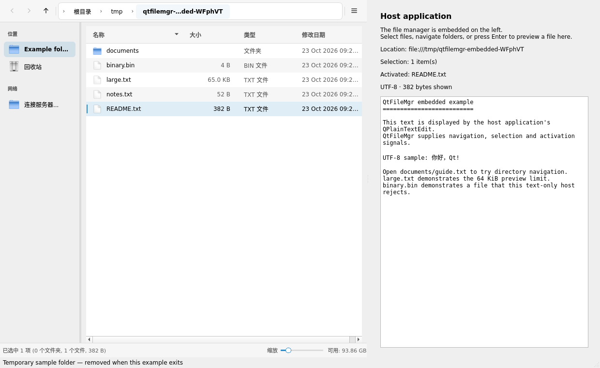
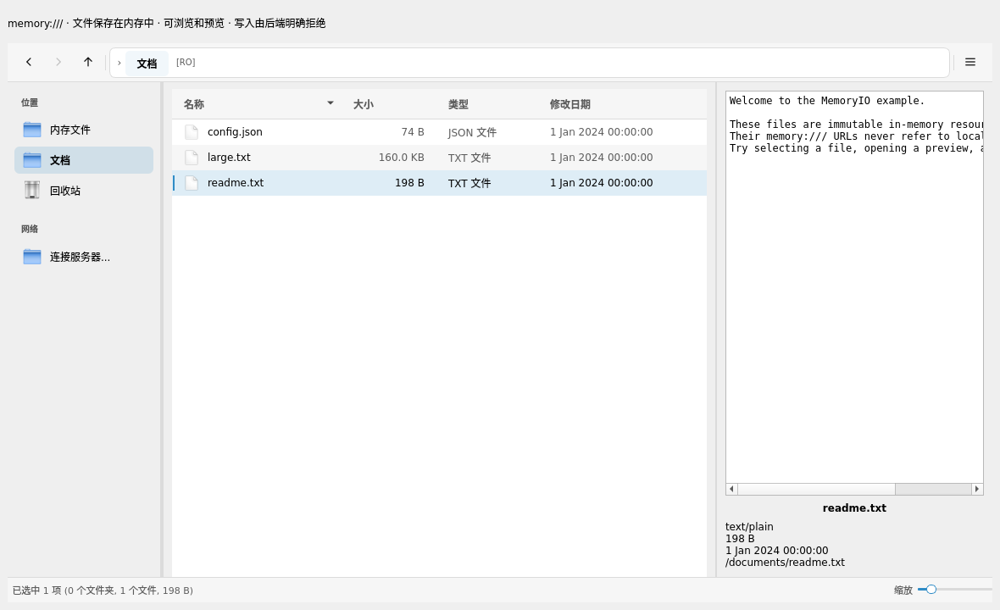

# 两个完整集成示例 / Complete examples

两个示例分别展示宿主窗口接入和自定义数据源接入。它们均使用公开头文件
与 `QtFileMgr::QtFileMgr`，在 SSH 关闭时也能运行。

## 编译并运行

在源码根目录执行：

```sh
cmake -S . -B build -G Ninja -DQTFILEMGR_QT_MAJOR=5 \
  -DQTFILEMGR_WITH_SSH=OFF -DQTFILEMGR_BUILD_EXAMPLES=ON
cmake --build build --parallel 2
./build/examples/embedded/qtfilemgr_example_embedded
./build/examples/memory_io/qtfilemgr_example_memory_io
(cd build && ctest --output-on-failure)
```

Qt6 使用 `-DQTFILEMGR_QT_MAJOR=6`。示例默认不构建，需显式开启
`QTFILEMGR_BUILD_EXAMPLES`；`BUILD_TESTING=ON` 时自动加入行为检查。

## 1. 嵌入现有窗口

源码：[examples/embedded/main.cpp](../examples/embedded/main.cpp)。



示例保留宿主 `QMainWindow`，在 `QSplitter` 左侧放入 `QtFileMgrWidget`，
右侧放入宿主自己的只读文本预览。默认创建临时样例文件，退出后清理；也可
显式传入本地目录：

```sh
./build/examples/embedded/qtfilemgr_example_embedded --directory /path/to/documents
```

宿主通过 `filesSelected` 更新选择信息，通过 `fileActivated` 决定如何预览，
通过 `urlChanged` 跟踪当前目录。预览限制读取大小，并显示路径和错误。
示例使用 UTF-8 文本演示；业务应用应按自己的文件格式和编码实现文档打开逻辑。

`QtFileMgrConfig` 显式传入组件；窗口和子控件使用 Qt 父子所有权。默认样例
目录在窗口销毁后才清理。导航范围与 UI 开关属于交互策略，不能作为安全沙箱。

## 2. 只读内存 IO

源码：[MemoryIO.h](../examples/memory_io/MemoryIO.h)、
[MemoryIO.cpp](../examples/memory_io/MemoryIO.cpp)、
[窗口入口](../examples/memory_io/main.cpp)。



`MemoryIO : QtFileMgrIO` 把示例目录和文件保存在内存数据结构中，以
`memory:///documents` 等 URL 展示。浏览和预览不需要真实文件或服务器。
它演示以下契约：

- `acceptsUrl`、`urlForPath`、`pathFromUrl` 明确 URL 归属及后端内部路径。
- 目录条目、`stat`、文件大小、MIME 类型和有大小上限的预览由后端提供。
- 列目录和预览请求在后续事件循环完成，调用方有时间连接结果信号。
- 请求响应取消，完成一次；请求或后端销毁时不会调用悬空对象。
- `canWrite()`、`isWritable()` 返回 false；UI 关闭创建、删除、重命名和拖放，
  后端也拒绝写操作并输出带路径的 `qWarning`。

这里 `isRemote()` 为 true 表示使用组件的非本地协议路径处理，
`RemoteCapability` 不代表实现了网络通信。组件导航通过后端的路径转换方法
处理自定义协议，不将 `memory:///` 解释成本地磁盘路径。

示例的异步实现只是把很小的内存读取延迟到下一个事件循环；真实网络或
大数据源应接入真正异步的客户端或 worker，避免把阻塞工作放到 GUI 线程。
数据不持久化，不实现写入、文件监控、外部导出或认证。替换为业务后端时，
按实际实现声明能力，并在后端执行访问权限检查。

注入的 IO 由宿主持有，必须与消费者位于同一 GUI 线程，并活到所有消费者
销毁之后。窗口入口中先构造 IO、再构造窗口，利用栈对象逆序析构满足此约束。

## 验证安装后的库

每个示例都可以作为独立工程构建，不需要引用库源码中的私有目录：

```sh
cmake --install build --prefix "$PWD/install"
cmake -S examples/embedded -B embedded-build -G Ninja \
  -DCMAKE_PREFIX_PATH="$PWD/install"
cmake --build embedded-build --parallel 2
cmake -S examples/memory_io -B memory-build -G Ninja \
  -DCMAKE_PREFIX_PATH="$PWD/install"
cmake --build memory-build --parallel 2
./embedded-build/qtfilemgr_example_embedded
./memory-build/qtfilemgr_example_memory_io
```

示例源码也安装到 `share/doc/QtFileMgr/examples/`。安装包选择的 Qt 主版本
必须与宿主一致。

## 自动检查与截图

在源码根目录使用已有隔离脚本；所有运行时用户目录均为临时目录：

```sh
python3 tests/run_isolated.py \
  --binary build/examples/embedded/qtfilemgr_example_embedded -- --smoke-test
python3 tests/run_isolated.py \
  --binary build/examples/memory_io/qtfilemgr_example_memory_io -- --smoke-test
python3 tests/run_isolated.py \
  --binary build/examples/memory_io/qtfilemgr_example_memory_io \
  -- --screenshot "$PWD/memory-example.png"
```

两个窗口均支持 `--screenshot PATH`，保存后退出。行为检查覆盖窗口信号联动、
选择、导航和实际预览；独立的 `qtfilemgr.memory_io` 测试覆盖 URL 边界、
预览上限、取消、销毁和写入拒绝。具体已运行组合见
[VALIDATION.md](VALIDATION.md)。

## English overview

- **Embedded host:** a regular `QMainWindow` owns a splitter containing a
  `QtFileMgrWidget` and its own bounded UTF-8 document preview. It handles
  `fileActivated`, `filesSelected` and `urlChanged`. Disposable demonstration
  files are the default; `--directory PATH` selects an existing local directory.
- **Read-only memory IO:** `MemoryIO` implements a virtual `memory:///` filesystem
  with deferred directory/preview requests, explicit URL ownership, bounded
  reads, cancellation and write rejection. Its non-local-path flag does not
  imply network transport. It is an educational backend with no persistence or
  external export. Real blocking I/O needs an asynchronous client or worker.
- Enable `QTFILEMGR_BUILD_EXAMPLES=ON` to build both in the source tree. Each
  example also builds independently against an installed package using
  `CMAKE_PREFIX_PATH`, as shown above. Neither example requires SSH.
- `--smoke-test` checks actual host interactions and exits; `--screenshot PATH`
  saves the demonstrated window and exits. CTest runs these checks with isolated
  settings and adds a separate backend contract test.
- The host owns an injected IO object. Keep it on the GUI thread and destroy all
  consumers before destroying the backend. Read-only UI flags complement backend
  enforcement; navigation restrictions are not a security sandbox.
